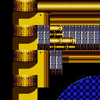

# lavesiime.github.io

***

# Sonic Origins 2.0.1

On August 24, 2023, the v2.0.1 update dropped for Sonic Origins. This update aimed to fix some issues with the collection as a whole, as well as fixing some things from the Plus DLC update. Sonic 1 and Sonic 2 were largely unchanged (aside from the Tails Moon Jump bug, but that's a story for another day..), but Sonic CD recieved a substantial list of changes. This random page i'm writing for no reason aside from throwing up the info on TCRF later prolly aims to go over ever single change in the update, both the ones listed and hidden, and see (er idk what else to say tbh, i dunno why i'm even writing an intro lol)

To start, let's go over level changes. There are only a few, but they're still notable.

When the Plus update dropped in v2.0.0, one of the monitors in Metallic Madness Zone 2 started acting all weird..

When Amy came out, many players found issues of Amy's.. new teleport ability. Somewhere along the 

Original notes:
- Metallic Madness Zone 2 item boxes location and contents are properly placed.
  - .\stages\(an)r82a\act2.bin - change Monitor @ entity pos 149 from Static High Plane to Rings Low Plane (like it should be)
  - .\stages\(an)r82c\act2.bin - ditto
  - .\stages\r82d\act2.bin - ditto
  - .\stages\anr82d\act2.bin - ditto, also adds an invis block at (7184, 1464) (it was a mini section and there was a hole in the wall) (this isn't in the normal version of the stage..?)

- In Quartz Quadrant Zone 2, Amy will no longer disappear as the camera moves away in certain conditions.
  - .\stages\r52c\128x128tiles.bin - changed the solidity of a tile in chunk 0x16C (used to not have solidity despite being a ramp, good change)

- In Boss Rush mode against Egg Tilter, Knuckles will have proper rolling animations from springs.
- Amy will now be able to complete stage loops while using her Rush Attack.
- In Sonic CD, Extras that are unlocked will now remain unlocked.
- In Sonic CD, Amy will appear in the proper coordinates after time travelling in certain levels.
  - .\stages\(an)r32a\act2.bin - added a few Time Warp Fix objects around (7008, 1428)

| v2.0.0  | v2.0.1 |
| ------------- | ------------- |
|  |  |

Also yeah that patch note that was like

-`Amy will now be able to complete stage loops while using her Rush Attack.`

Yeah that was an absolute lie, they didn't change a single thing relating to the Hammer Rush in CD (or S1 or S2 or seemingly S3K) for that matter, so...

Script changes:
- SignPostM094 out of bounds check - used in MR62A/MR81A/DR71A
- Player Object changes
- R1 tubeswitch - climbing anim
- R3 tube switch - more climbing stuff
- R4 air bubble - restore gliding animation after a bubble, instead of using the walking animation
- R8 conveyor wheel - Player_State_GlideSlide stuff
- Title/Select - always use Sonic's save data
